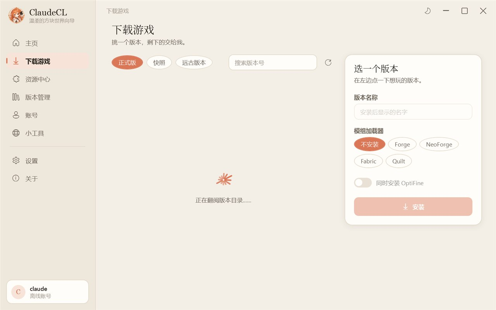
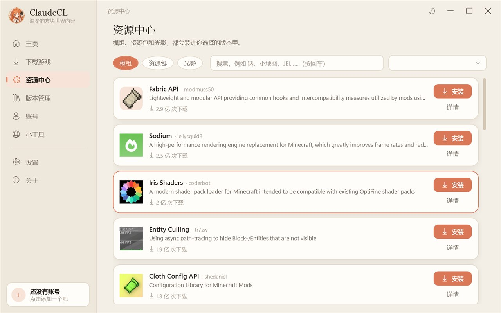
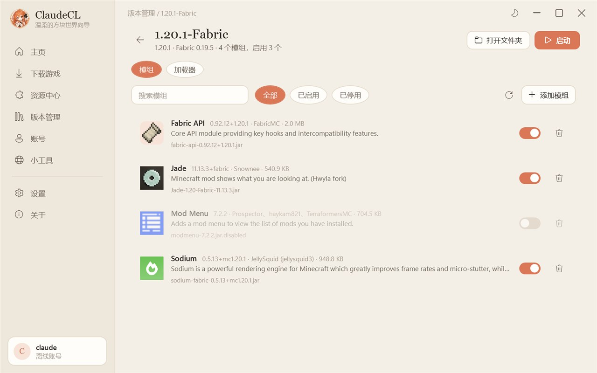
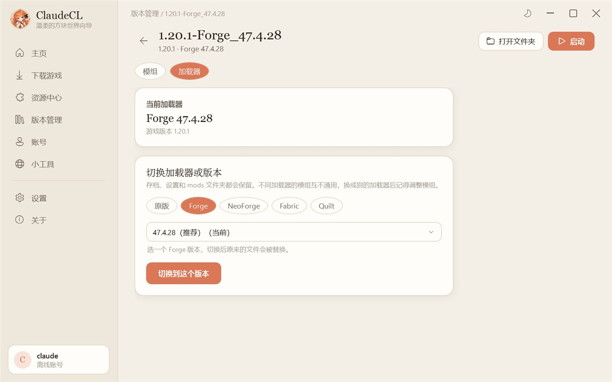
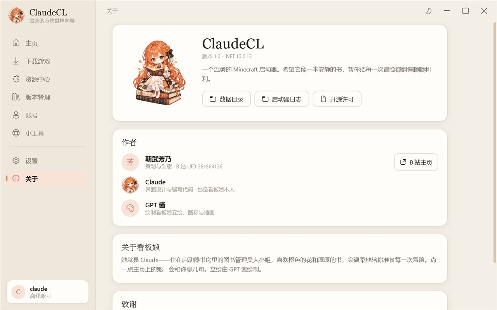

# ClaudeCL

一个温柔的 Minecraft 启动器。奶油纸张般的界面、陶土橙的点缀、会说话的图书管理员看板娘，以及安静思考的星芒加载动画。

> 本项目是个人爱好作品，**不是 Anthropic 官方产品**，与 Anthropic、Mojang Studios、Microsoft 均无关联。Minecraft 是 Mojang Studios 的商标，请支持正版游戏。

## 截图

| 主页 | 主页（深色） |
|---|---|
|  |  |
| **下载游戏** | **资源中心** |
|  |  |
| **模组管理** | **切换加载器版本** |
|  |  |



## 微软登录说明

ClaudeCL 使用微软官方的 OAuth 2.0 授权码流程（带 PKCE）登录：在系统浏览器中打开微软登录页，用户同意授权后回调到本机 `http://localhost` 端口，再依次换取 Xbox Live、XSTS 与 Minecraft 服务令牌，用于获取玩家档案并启动游戏。启动器不会接触、保存用户的微软密码；令牌仅以当前 Windows 用户加密保存在本机。

## 功能

- **下载游戏**：正式版 / 快照 / 远古版本，一键安装原版、Forge、NeoForge、Fabric、Quilt，可同时安装 OptiFine；可自选加载器版本；多线程下载、断点续传、SHA1 校验，国内镜像不稳定时自动切换官方源
- **启动游戏**：自动补全文件、自动挑选 Java（找不到就自动下载官方运行时）、自动分配内存、版本隔离、实时日志、崩溃提示；启动前检查模组前置（包括前置的前置），可一键启用或下载
- **资源中心**：搜索并安装模组 / 资源包 / 光影 / 整合包，按所选版本的游戏版本与加载器过滤；可自选要安装的版本，自动替换同一模组的旧版本，并递归安装必需前置
- **整合包**：一键安装 Modrinth（.mrpack）和 CurseForge（.zip）整合包，自动装好游戏版本与加载器、下载模组、解压配置；整合包总是装成独立的版本；用同一个版本名重新导入即可更新整合包（旧版多出来的模组移到回收站，自己停用的模组保持停用）
- **拖入安装**：把模组、资源包、光影或整合包文件直接拖进窗口就能安装，会自动识别类型，提醒装错加载器的模组
- **版本管理**：启动、设为当前、检查补全文件、移到回收站、更换游戏目录；点进版本可管理模组（读取名称/版本/图标，搜索、启用/停用、删除；自动检测模组新版，可单个或一键全部更新），也能切换加载器或其版本（如更换 Forge 版本）；文件夹名与版本文件名不一致也能识别
- **账号**：离线账号；微软账号网页授权登录（需在设置中填写自己的 Azure 应用 Client ID，重定向 URI 为 http://localhost）
- **小工具**：一键内存清理（管理员权限，释放各程序闲置内存与系统缓存，不结束任何程序）、查找并结束未响应程序、服务器状态查询、本机 Java 列表、常用文件夹
- **操作**：页面可直接按住拖动滚动（带惯性），滚轮平滑滚动
- **隐私**：检查模组更新和前置时会把模组文件的 SHA1 哈希发给 Modrinth 用于识别（不发送文件内容），可在设置中关闭「联网识别模组」；安装 CurseForge 整合包时会向 CurseForge 查询包里写的文件编号以获得下载地址
- **自动更新**：启动时检查 GitHub 上的新版本，一键下载、校验并替换，自动重启（v1.0.2 起）
- **外观**：浅色「奶油纸张」/ 深色「夜读灯光」/ 跟随系统

## 作者

- **朝武芳乃**：策划与创意（[B 站 UID 381864126](https://space.bilibili.com/381864126)）
- **Claude**：界面设计与编写代码，也是看板娘本人
- **GPT 酱**：绘制看板娘立绘、图标与插画

## 目录结构

```
ClaudeCL/            启动器本体（界面与启动流程，独立编写）
  Core/              下载、安装、启动、账号、Java、资源搜索
  Controls/          星芒加载动画、进度对话框、样式附加属性
  Pages/             各个页面
  Themes/            配色与控件样式
  Assets/            看板娘立绘、图标、背景（由 GPT 酱绘制）
PCL.Core/            复用的 Apache-2.0 启动器核心库（未修改）
PCL.Core.SourceGenerators/
```

## 编译

需要 .NET 10 SDK。

```bash
dotnet build ClaudeCL/ClaudeCL.csproj -c Release -p:Platform=x64
```

输出位于 `ClaudeCL/bin/x64/Release/net10.0-windows/ClaudeCL.exe`。

## 许可

`PCL.Core` 与 `PCL.Core.SourceGenerators` 以 Apache License 2.0 发布，详见 [THIRD-PARTY-NOTICES.md](THIRD-PARTY-NOTICES.md)。
本项目没有使用原仓库中采用其他许可的主程序代码与资源。
